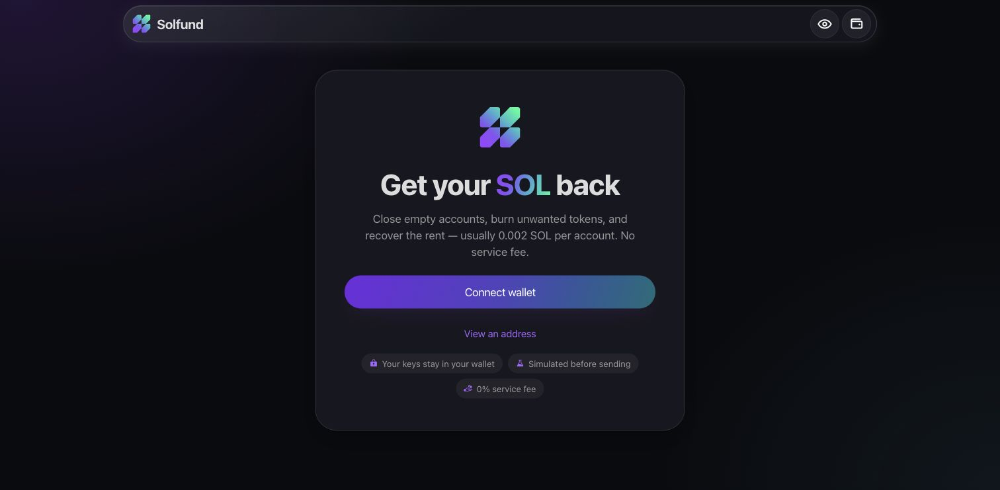

<p align="center"></p>

<h1 align="center">Solfund</h1>

<p align="center">Get your SOL back.</p>

<p align="center"><a href="#quick-start">Run locally</a> · <a href="design/README.md">Design & branding</a> · <a href="docs/ARCHITECTURE.md">Architecture</a> · <a href="docs/VERIFICATION.md">Verification</a></p>



Solfund is a local Solana app for reclaiming account rent, burning unwanted tokens, and claiming supported Pump.fun and PumpSwap cashback. It uses an English interface with locally bundled UI assets. Solfund adds no service fee; Solana network fees still apply.

This is a development project. Passing tests does not make it an audited or production-ready wallet application. See [verification and limits](docs/VERIFICATION.md).

The repository is private. Public publication and deployment require separate owner approval.

## Features

- Scan SPL Token and Token-2022 accounts for a connected wallet, or inspect an address without connecting.
- Preview and simulate actions before requesting a wallet signature.
- Close eligible empty accounts and optionally burn selected token balances before closing their accounts.
- Detect supported Pump cashback and reclaim eligible reward-account rent. Accounts with pending token incentives, other token rewards, or unknown fields remain open.
- View locally recorded claims, cumulative charts, network fees, and net amounts for 7 days, 30 days, or all time.

NFT burning, Pump token-incentive claims, non-SOL cashback, and other protocol rewards are not implemented.

## Design included

The full English interface, editable SVG mark, local icon fonts, Apple-style component layer, responsive styles and Account charts are included. The existing typography and supplied logo are preserved. See the [design source map and visual rules](design/README.md).

## Quick start

Clone this repository, open its directory, and run:

```bash
./setup.sh
npm start
```

Open [http://127.0.0.1:8790](http://127.0.0.1:8790). Use a compatible Wallet Standard browser wallet, such as Phantom, Solflare, or Backpack. Wallet-specific and mobile compatibility still needs independent testing.

Node.js 24 or newer is required; Node.js 24 is recommended. npm is needed for the development dependencies and test suite. The app and local server themselves use no installed runtime packages or build step.

To run the server without installing test dependencies:

```bash
node serve.mjs
```

## Configuration

The default upstream is Solana's public mainnet RPC. Public RPC limits may prevent some account requests; a provider endpoint can be supplied through the environment. Keep RPC credentials on the server and out of browser files.

`npm start` loads `.env` if present. Use `SOLFUND_RPC_URL` for the upstream endpoint and `SOLFUND_PORT` for the local port. The legacy `LEERGUT_RPC_URL` and `LEERGUT_PORT` names remain supported; the Solfund names take precedence. `node serve.mjs` uses exported environment variables directly. See [.env.example](.env.example) for example settings. See [AGENTS.md](AGENTS.md) for concise commands and [architecture](docs/ARCHITECTURE.md) for the request flow.

## How it works

1. Connect a wallet or choose **View an address**.
2. Review the selected accounts and rewards. Empty accounts and supported Pump claims are selected initially; token balances require an explicit selection.
3. Choose **Review selection**. Solfund simulates each batch and shows what would be burned, reclaimed, or skipped.
4. Approve the intended actions in the wallet. Burning is permanent. The app monitors submitted signatures and links to the explorer.

The **Account** button opens history recorded by this browser, separated by wallet. It starts with claims submitted through this feature; it does not import a wallet's complete transaction history. Known signatures are checked against the blockchain. Amounts remain marked as estimates until transaction balances and fees are available. Clearing browser storage removes this local record.

## Data and trust

The local server forwards a restricted set of RPC requests to the configured Solana endpoint. The browser also requests USD prices from Jupiter, which receives the requested mint addresses and the browser's IP address. Prices are informational and may be unavailable or stale.

Wallet private keys and recovery phrases are never requested by Solfund. The connected wallet signs transactions. A wallet's signing and sending capabilities affect which checks the app can perform; see [SECURITY.md](SECURITY.md). Browser history is not a complete financial ledger.

## Development

```bash
npm ci
npm run check
npm test
npm run test:coverage
```

Tests include instruction comparisons against the official Solana libraries, LiteSVM execution, the local HTTP/RPC proxy, history reconciliation, and a full app-entry-point flow with a synthetic DOM and test wallet. See [docs/VERIFICATION.md](docs/VERIFICATION.md) for what has and has not been verified.

The current development dependency audit has three known high-severity entries from one unpatched `bigint-buffer` dependency chain; the runtime-only audit is clean. Details and the tested compatibility override are recorded in [docs/DEPENDENCIES.md](docs/DEPENDENCIES.md).

`tools/demo-chain.mjs` is a local test fixture. `tools/mainnet-sim-check.mjs` makes real RPC reads and simulations and is not part of the offline test suite. Neither tool is a production server.

## Hosting

The app needs a server-side `/rpc` endpoint. Uploading only `site/` to GitHub Pages or another static host is insufficient. The supplied server binds to loopback and checks its own host and origin; public deployment requires a separately reviewed HTTPS configuration, appropriate origin handling, rate limiting, credential management, and privacy disclosures. Publishing a repository does not deploy the app.

## Using with Codex

[AGENTS.md](AGENTS.md) gives coding agents the actual commands, architecture, compatibility constraints, and transaction-safety boundaries. Start a Codex session in the repository and ask it to read that file before changing code.

## Contributing and licensing

Read [CONTRIBUTING.md](CONTRIBUTING.md) and [SECURITY.md](SECURITY.md). Bundled third-party assets retain their own licenses in `site/vendor/`. Check the repository's license and asset notices before redistribution.

The proposed code license is [MIT](LICENSE.proposed-MIT), pending the project owner's choice before public publication. See [third-party notices](THIRD_PARTY_NOTICES.md) and the [publishing guide](docs/PUBLISHING.md).
