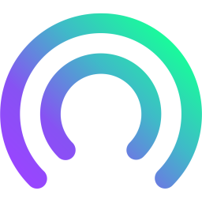

# Solstake design

This repository includes the complete implemented visual interface and its local assets. These are the source files used by the application, rather than a screenshot-only mockup.

## Brand assets

| Asset | Source | Use |
| --- | --- | --- |
| Application mark | [`../site/icon.svg`](../site/icon.svg) | Header, start screen, browser icon |
| Editable source mark | [`branding/source-logo.svg`](branding/source-logo.svg) | Standalone vector source supplied for this project |
| Design credit logo | [`branding/xyz-studios.svg`](branding/xyz-studios.svg), [`../site/assets/xyz-studios.svg`](../site/assets/xyz-studios.svg) | Supplied XYZ STUDIOS mark; artwork preserved, viewBox fitted to remove empty artboard space |
| Earlier layout preview | [`../docs/images/preview.jpg`](../docs/images/preview.jpg) | Archived layout reference; predates the replacement logo |

Both SVGs contain the same supplied 256 × 256 mark, with its original geometry and a continuous Solana-style gradient from purple (`#9945FF`) through turquoise (`#43B4CA`) to green (`#19FB9B`), matching the inline SOL symbol. A viewBox allows it to scale in the header, start screen and browser icon. The Affinity document for the earlier logo is preserved separately as a private historical source because it contains workstation metadata. It is excluded from Git and the source archive; the current editable SVG remains included.

## Interface layers

| Layer | Source of truth | Responsibility |
| --- | --- | --- |
| Component base | [`../site/vendor/puppertino/`](../site/vendor/puppertino/) | Bundled Puppertino CSS and modal/sheet helpers |
| Apple-style adaptation | [`../site/apple-ui.css`](../site/apple-ui.css) | Spacing scale, shared controls and component corrections |
| Solstake theme and layout | [`../site/app.css`](../site/app.css) | Brand colors, floating header, materials, account rows, dialogs and responsive layouts |
| Account view | [`../site/account.css`](../site/account.css), [`../site/js/account-view.js`](../site/js/account-view.js) | Claim totals, chart, transactions and history states |
| Main views | [`../site/js/views.js`](../site/js/views.js), [`../site/index.html`](../site/index.html) | Start, account selection, wallet menu and claim flow |
| Icons | [`../site/vendor/phosphor/`](../site/vendor/phosphor/) | Local bold/fill icon fonts with their license |

Styles are loaded in this order: Puppertino, `apple-ui.css`, `app.css`, then `account.css`. Keep application-specific overrides in the application styles instead of modifying the vendored component library.

## Color and type

| Role | Current value |
| --- | --- |
| Logo gradient | `#9945FF` → `#43B4CA` → `#19FB9B` |
| Brand purple | `#9945FF` |
| Indigo | `#8752F3` |
| Teal | `#3FBAC8` |
| Green | `#19FB9B` |
| Dark page | `#0A0B0F` |
| Light page | `#F5F5F8` |

The logo uses the same purple-to-green gradient colors as the inline SOL symbol. SOL amounts and accent controls retain their existing gradients. Controls use the existing accessible contrast treatment in the CSS. Status is conveyed with text and icons as well as color.

The typography uses the existing system-font stack. No new webfont, Apple font file, or SF Symbols package is included. Phosphor supplies the icon glyphs.

## Layout and interaction

- A floating capsule header contains refresh, wallet and the circular **44 × 44 px Account icon**.
- Claim review offers two equally sized controls. **Claim with Tip** uses the prominent Solstake treatment; **Claim without Tip** uses a neutral treatment. Both remain directly visible and show their estimated net payout. The optional 20% amount and recipient are disclosed before approval; token-burning labels remain explicit.
- SOL and USD summaries sit beside each other on wider screens and stack on narrow screens. The token list spans the content width below.
- The content maximum is 1180 px, increasing to 1280 px on very wide screens. Cards use a 28 px radius. Shared spacing follows a 4 px scale.
- Glass is concentrated in navigation and modal controls. Content cards use a stable surface for readable values and descriptions.
- Mobile token rows keep account names, descriptions and amounts readable. Long dialog messages scroll while their actions remain available.
- Account history provides 7-day, 30-day and all-time views, a cumulative chart, an accessible data table, explicit transaction status and explorer links.
- The interface language is English. Numbers use decimal points, USD uses the dollar format, and dates use `en-US` formatting.
- The styles include reduced-motion, reduced-transparency and increased-contrast treatments. This is not a claim of complete accessibility conformance.

## Preserve when changing the design

Keep the supplied logo geometry and current typography. Show pending claims separately from confirmed totals. Do not let visual changes hide token-burn warnings, storage errors, account restrictions, network fees or transaction status.

The recorded browser checks and their limits are in [`../docs/VERIFICATION.md`](../docs/VERIFICATION.md). Vendor licensing and mark ownership are recorded in [`../THIRD_PARTY_NOTICES.md`](../THIRD_PARTY_NOTICES.md).

The compact footer contains three equal-width, 80 px high links in one shared grid: X, the XYZ STUDIOS website and the Solstake repository. All three use the same surface, border, 36 px logo frame, caption style, focus treatment and hover state. The X and GitHub marks are original white SVGs from their official brand toolkits, displayed at 36 px; the supplied wide studio wordmark fits the same frame without stretching. The footer adapts to light/dark appearance and reserves room for the mobile claim control.
